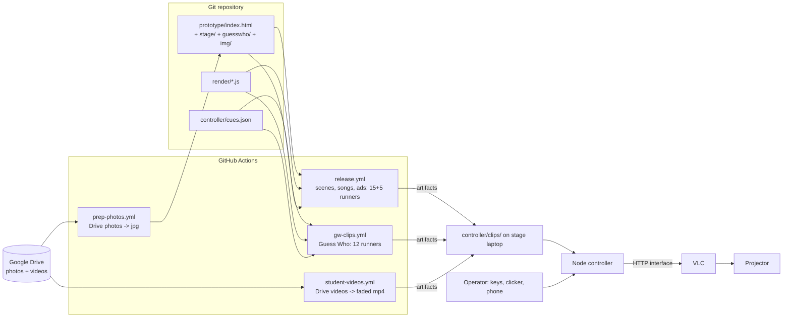

# Technical guide

How NDPify is built, why, and where each piece lives. For step-by-step jobs see [how-to.md](how-to.md). Rules for AI agents are in [../AGENTS.md](../AGENTS.md).

## Contents
1. [Design decisions](#design-decisions)
2. [Architecture](#architecture)
3. [Prototype](#prototype)
4. [Render pipeline](#render-pipeline)
5. [Controller](#controller)
6. [CI workflows](#ci-workflows)
7. [Branches and releases](#branches-and-releases)
8. [Quality settings](#quality-settings)
9. [Student videos and secrets](#student-videos-and-secrets)
10. [Tests](#tests)
11. [Verified findings and gotchas](#verified-findings-and-gotchas)

## Design decisions

- **Pre-rendered clips + remote control, not a live UI.** The school laptop is weak; OBS and live rendering lag. VLC plays video fine. So the show is clips, and the operator owns timing (kids sing live, length unknown).
- **No song titles, progress bar or timer on screen**, because timing is unknown. Playlist rows list performers only.
- **Every clip starts on the previous clip's last frame** (or fades up from black for a new scene) so cuts are invisible. `render/check-seams.js` measures this.
- **Heavy work on GitHub Actions**: renders need many CPU cores and a clean environment; the laptop must stay free. Local = edit, git, download, test.
- **Clips are not in git** (size, privacy). Workflows regenerate them from source; artifacts last 1-3 days.
- **Content is data in one HTML file** so a new person can change names, photos and order without learning video tools.
- **Transform/opacity-only animation** keeps the look consistent and cheap.

## Architecture



## Repository map

| Path | Purpose |
|---|---|
| `prototype/index.html` | All scenes. `CONFIG`, `songs[]`, `artists[]`, `guessWho` at the top of the script; `cues` array near the bottom drives the page (`gwCue`, `NEXT_SONG`). Exposes `window.__ndpify` hooks used by the renderer (`go()`, `idle()`, ...). |
| `prototype/stage/` | Standalone pages for song loops and standby screens (functions of time with a 20 s period). |
| `prototype/guesswho/gw.js` | Guess Who card: mystery, reveal, dismiss. `GW.calcTiming` sets the guess timer from the number of "then" photos (6/8/10 s). |
| `prototype/img/guesswho/` | `sources.json` (Drive id -> slug/slot) and the converted `<slug>_<slot>.jpg` photos. |
| `review/server.js` | Static server for the prototype on port 4000 (+ a tiny approval hub). The renderer loads `http://localhost:4000/prototype/index.html`. |
| `render/capture.js` | Deterministic capture with Chromium (Playwright) + CDP virtual time: steps exactly 1/FPS per frame, so output does not depend on machine speed. |
| `render/render-full.js` | Defines every **segment** (id, steps, tail), shards them over N machines (`--shard=I/N`, weights from `shard-weights.json`, default 300), encodes each with ffmpeg, optionally joins (`--join`). `--only=a,b` substring filter, applied before sharding. |
| `render/render-long.js`, `loops.js` | 17-minute seamless loop clips (songs, standby, ad): capture one loop period and repeat it; every infinite animation period must divide the loop period. |
| `render/collect-clips.js` | Maps segments to controller clip names, builds scene clips (joins slices, adds sound, fade-from-black where needed). `-` as loops dir = Guess Who only. |
| `render/audio.js`, `soundtrack.js`, `audio/` | UI sound effects mixed into scene clips. |
| `render/check-seams.js` | Last frame of clip N vs first frame of clip N+1 for every Guess Who cut (mean abs luma diff on 64x36, limit 8), plus "first frame is black" for the first round. |
| `render/prep-photos.js` | CI only: download Drive photos, EXIF-rotate, downscale to max 2400 px, JPEG quality 95, contact sheet. No cropping. |
| `render/preview.js` | Contact sheet of produced clips for test runs. |
| `controller/` | See [Controller](#controller). |

## Prototype

Open `prototype/index.html` in Chrome. Keys: `Space`/`Right` next cue, `Left` replay previous, `1`-`7` jump to a scene, `F` fullscreen, `H` hide the cue indicator, `T` reveal a song title on Now Playing (off on purpose). Press any key once first so the browser allows sound.

Edit the config at the top of the `<script>`:
- `CONFIG`: school name, colours, ad-break copy, plans, playlist options.
- `songs[]`, `artists[]`: names, covers, gradients.
- `guessWho.students[]`: per kid `name`, `photos` (the "then" photos, 1-4), `posT` (CSS `object-position` per then photo), `now` and `posN` (today's photo), or `nowPhotos`/`posNs` for several cross-fading "now" photos. Framing is CSS only; photo files are never cropped.

Cue count of the prototype: 8 fixed cues, then 3 per kid, then the next-song cue (`NEXT_SONG = 8 + 3 * students`).

## Render pipeline

1. A **segment** is a short capture of the page: `{ steps: [{ cue }, { state, hold }], tail, range? }`. Segment ids look like `009_gw1_mystery`. They are listed in `render-full.js`.
2. Each machine renders its share (`--shard=I/N`): capture PNG frames at 1920x1080, 60 fps, encode with x264 (CRF 10, `veryslow`, maxrate 60M).
3. `collect-clips.js` renames Guess Who segments to controller clip names, builds the scene clips (`00_idle_blur`, `01_store_download`, ... `06_adbreak_intro`), adds sound, and fades up from black the clips listed in `FADE_IN` (new scenes: `06_adbreak_intro`, `12_gw1_guess`). Songs, standby and ad loops come from `render-long.js` (17 minutes each; a short loop that ends visibly is the risk, long is free).
4. Output is one artifact of ready-to-play files named exactly as in `cues.json`.

`003_open` is the heaviest scene (785 frames), so it is split into three slices on three machines (`003a/b/c_open`); the earlier frames are still stepped (not saved), so slices join seamlessly.

Clip naming for Guess Who (kid `k`, 1-based): `12+3(k-1)` = `_gwK_guess`, +1 `_gwK_reveal`, +2 `_gwK_off`.

## Controller

Node + Express. Files:

| File | Role |
|---|---|
| `cueState.js` | Pure state machine: cue list validation (`mode` must be `hold`/`loop`), index, next/prev/jump. |
| `controller.js` | Debounce (300 ms), logging, calls into VLC, `tick()` every 500 ms that restarts a `loop` cue VLC parked at its end (unless the operator paused). |
| `vlc.js` | VLC HTTP interface client (`requests/status.json`, Basic auth with empty user and `VLC_PASSWORD`, default `farewell`). |
| `vlcProc.js`, `launch.js` | Find VLC, build args (`--play-and-pause`, `--no-qt-video-autoresize`, fullscreen on a chosen screen), pick free ports, detect displays, write `start.generated.bat`, run it in its own console. `--dry-run` only checks. |
| `displays.js` | Windows display list + screenshot via PowerShell. |
| `server.js` | Express app, keyboard handler (raw mode), QR code, API below. |
| `public/index.html` | Operator dashboard and phone remote. |
| `start.sh`, `start.bat`, `gen-dummy-clips.sh` | Legacy launchers (default VLC port 8080) and practice clips. Prefer `launch.js`. |

API (no authentication; private network only):

| Route | Purpose |
|---|---|
| `GET /api/state`, `GET /api/cues` | current/next cue and the full list |
| `POST /api/next`, `/api/prev`, `/api/replay`, `/api/pause` | operator actions |
| `POST /api/jump/:n` | jump to cue number n (1-based) |
| `POST /api/cue/:id` | body `{"mode":"hold"|"loop"}`: change a cue's mode, saved to `cues.json` |
| `POST /api/clip/:id` | replace a cue's video file (raw body, filename in `x-filename`, video extensions only, 6 GB limit); the dashboard uses it |
| `GET /api/vlc`, `POST /api/fullscreen` | VLC status, fullscreen toggle |
| `GET /api/displays`, `GET/POST /api/screen` | list screens, read/set the projector screen |
| `GET /api/screenshot.jpg[?screen=N]` | live preview |

Environment variables: `VLC_PASSWORD` (default `farewell`), `VLC_PORT`, `PORT` (3000), `VLC_BIN`. `launch.js` picks free ports itself.

### cues.json

```json
{ "id": "12_gw1_guess", "file": "12_gw1_guess.mp4", "mode": "hold", "label": "Act 2 · Guess who 1/14 (...): ..." }
```

`hold` = VLC plays then freezes on the last frame (`--play-and-pause`). `loop` = the controller restarts the clip when VLC parks it at the end. Labels start with the run-of-show row number so the operator can follow the printed sheet. Order = array order.

## CI workflows

| Workflow | Trigger | What it does | Output |
|---|---|---|---|
| `ci.yml` | PR to `main`/`release`, push to other branches | Controller tests, render deps, smoke render of `000_idle_blur` at 60 fps; blocks PRs into `release` unless the source branch is `main` | pass/fail |
| `release.yml` | push to `release`, or manual with `only=` | `plan` -> `render` (15 Windows machines) -> `publish` (join + GitHub release with the full MP4) ; `loops` (5 machines: songs, standby, ad); `clips` collects everything | artifact `controller-clips`, release `build-<run>`; test runs (`only=`) make a `preview` contact sheet instead |
| `gw-clips.yml` | manual: `branch`, `only` (default `_gw`) | Guess Who rounds only, **12 Windows machines**, then collect + seam check; ~20 minutes | artifact `controller-clips-gw` (42 clips), `preview` sheet; with `only=_gw5,_gw2` just those rounds |
| `prep-photos.yml` | manual: `branch` | downloads Drive photos from `sources.json`, converts, commits jpgs back to the branch | jpgs in git, artifact `photo-contact-sheet` |
| `student-videos.yml` | manual | 8 parallel runners download student videos from Drive (ids from secret), fade in/out, re-encode, check edge frames are black | artifacts `student-clip-<name>`, `student-preview-<name>` |

Concurrency: GitHub allows 20 concurrent runners. `gw-clips` (12) and `student-videos` (8) fit together; a full `release` (15 + 5) fills the limit.

Artifact retention: 1 day (student videos), 2-3 days (renders). Download promptly.

`workflow_dispatch` workflows must exist on `main` to be dispatchable. `gh workflow run <file> --ref main -f branch=<feature-branch>`.

## Branches and releases

```
feature/<name>  --PR-->  main  --PR-->  release
```

- PRs into `main` run CI. PRs into `release` must come from `main`.
- A push to `release` renders the entire show (about an hour on 20 machines), publishes `build-<run>` with the joined 1080p60 MP4, and produces the `controller-clips` artifact (the full 74-clip set minus student videos). The joined MP4 is a **public** release asset on a public repo: consider that before releasing.
- You rarely need a full release. To refresh only the Guess Who clips, use `gw-clips.yml`.

## Quality settings

| Item | Value |
|---|---|
| Resolution, fps | 1920x1080, 60 fps (capture viewport = output, device scale factor 1: pixel exact) |
| Codec | x264 High, `-preset veryslow -crf 10 -maxrate 60M -bufsize 120M`, yuv420p, bt709, `+faststart` |
| Why the maxrate cap | keeps bitrate inside what VLC decodes smoothly on a weak laptop |
| Student videos | native resolution and fps (31 fps conformed to 30), CRF 10 `veryslow`, AAC 256k, 0.8 s fades |
| Fades | scene-entry clips 0.6 s fade from black (baked in); student videos 0.8 s in, and out except the Netflix intro which holds on its title card |

Env knobs: `FULL_CRF` (default 10), `FULL_POOL` (parallel browsers per machine; 1 on CI), `NDPIFY_FPS`, `NDPIFY_URL`.

## Student videos and secrets

- The 8 student videos live on Google Drive, shared "anyone with the link" so the runner can download them. They are never committed.
- Their file ids are in the repo secret **`STUDENT_VIDEO_IDS`**: a JSON object `{ "<clip name>": "<drive file id>", ... }` with keys `v01_netflix_intro`, `v02_first_steps_jr`, `v03a_tour_class8`, `v03b_tour_class9`, `v03c_tour_class10`, `v04a_sr_edit`, `v04b_last_school`, `v05_finale`.
- Set or change it with `gh secret set STUDENT_VIDEO_IDS < ids.json` (owner only). Keep the JSON file outside the repo. The workflow masks the id in logs.
- The workflow checks that the download is a video (Drive returns an HTML sign-in page for unshared files) and that the first frame (and last, where a fade-out is expected) is black.
- Guess Who **photos** are different: their Drive ids are in `prototype/img/guesswho/sources.json` and the converted jpgs are committed. That is why the repo should be private or limited to the team.

## Tests

```bash
cd controller && npm test                    # state machine, debounce, loop watcher, launcher, mock VLC (13 tests)
node render/collect-clips.test.js            # clip naming/planning
node render/prep-photos.js --selftest        # photo naming + contact-sheet grid
node render/check-seams.js --selftest        # seam math
```

CI also runs the controller tests and a smoke render on every PR. Real VLC and the real projector are **not** covered by tests; rehearse on the real setup.

## Verified findings and gotchas

Verified on VLC 3.0.24 on the Windows test laptop (two displays):
- `--play-and-pause` overrides repeat: a "loop" cue does not loop by itself, it parks paused at the end. Fix = the controller's `tick()` restart (`seek val=0` + `pl_play`). Verified: wrapped 3 times in 40 s.
- Hold cues freeze at the end (`paused`, time = length-1); pause/resume works.
- Sending `pl_empty` before each `in_play` made VLC tear down its video window (white flashes, window resized). The controller now appends and plays without `pl_empty`, and VLC runs with `--no-qt-video-autoresize`.
- `--qt-fullscreen-screennumber` is **0-based** on the test setup; an out-of-range number silently falls back to the primary screen. Re-check on the venue laptop.
- Port 8080 was held by an unrelated Windows service on the dev laptop; the launcher scans for a free port.

Not verified: fullscreen look on the real projector (hold frame vs black, tiny flash risk), audio over HDMI at the venue, the dashboard and QR on every phone, real-VLC playback of the final 60 fps CRF 10 clips on the stage laptop.

CI traps:
- A workflow with a literal newline inside a quoted shell argument (for example in `tr`) can make GitHub drop `workflow_dispatch`. Use shell helper functions.
- Windows runners render (the Remotion ffmpeg is a Windows build); Ubuntu runners do collect/seam/student jobs with apt ffmpeg, which has the `fade` filter.
- Fails with "not a video" mean the Drive file is not shared publicly.
- `main` rejects direct pushes: always use a PR (the owner can admin-merge).
